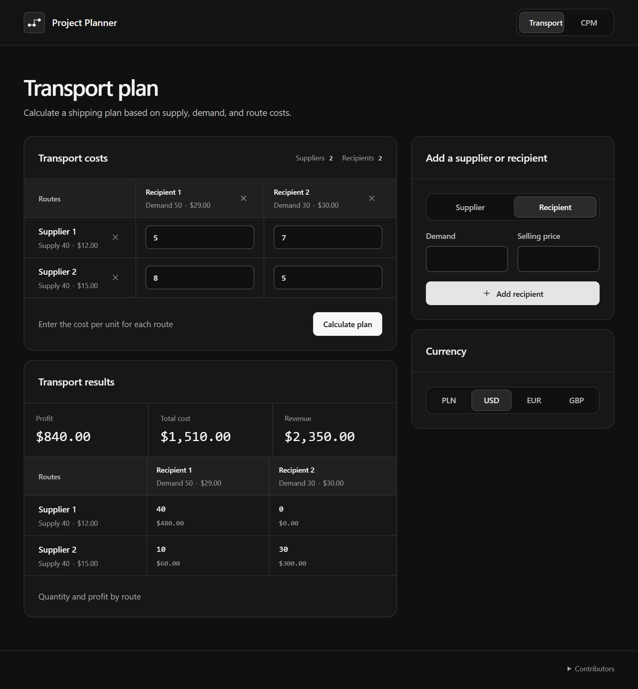
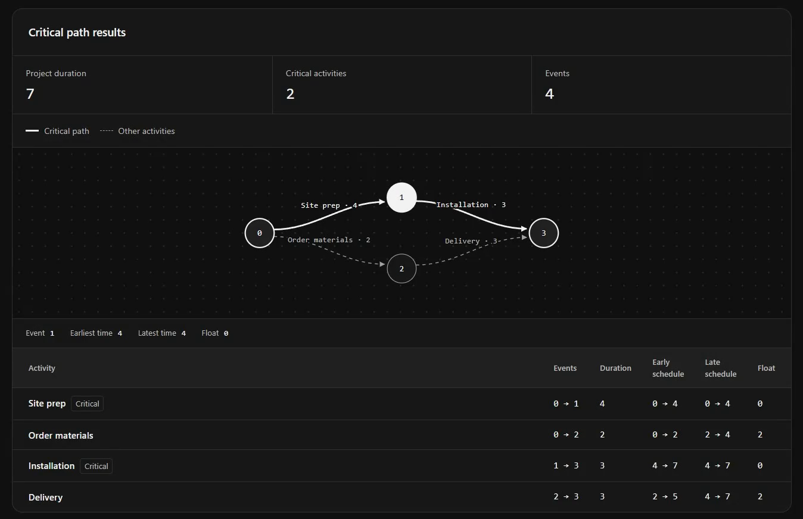

# Project Planner

Plan shipments and find a project's critical path. The app pairs a React and TypeScript frontend with a C# API.

## See the app in action

| Transport plan | Critical path |
| --- | --- |
| [](docs/showcase/transport-plan.png) | [](docs/showcase/critical-path.png) |
| Enter supply, demand, purchase prices, selling prices, and route costs. Review the shipment quantities, total cost, revenue, and profit. | Enter activity durations and their start and finish events. Review the project duration, critical activities, and schedule float. |

## Run locally

You need Node.js with npm and a .NET SDK. The API targets .NET 7.

1. From the repository root, trust the local HTTPS development certificate.

   ```powershell
   dotnet dev-certs https --trust
   ```

2. If you have the .NET 8 runtime and lack the .NET 7 runtime, run `$env:DOTNET_ROLL_FORWARD = 'Major'` in PowerShell.

   Start the API in the same terminal.

   ```powershell
   dotnet run --project "Backend/Project Planner/ProjectPlanner.Application" --launch-profile Project_Planner
   ```

3. In a second terminal, start the frontend from the repository root.

   ```powershell
   cd Frontend/project-planner-frontend
   npm ci
   npm start
   ```

4. Open [Project Planner on localhost](http://localhost:3000). To inspect the API, open [Swagger UI](https://localhost:44363/swagger).

The frontend uses port `3000` and calls the API on HTTPS port `44363`. If the page loads but calculations fail, check that Swagger UI opens without a certificate error.

## Check changes

On Windows, stop the API before you run the backend tests. From the repository root, run the test suite.

```powershell
dotnet test "Backend/Project Planner/Project Planner.sln"
```

If you use the .NET runtime override, set it in the test terminal too.

See the [frontend command reference](Frontend/project-planner-frontend/README.md) for type checking and production builds.
